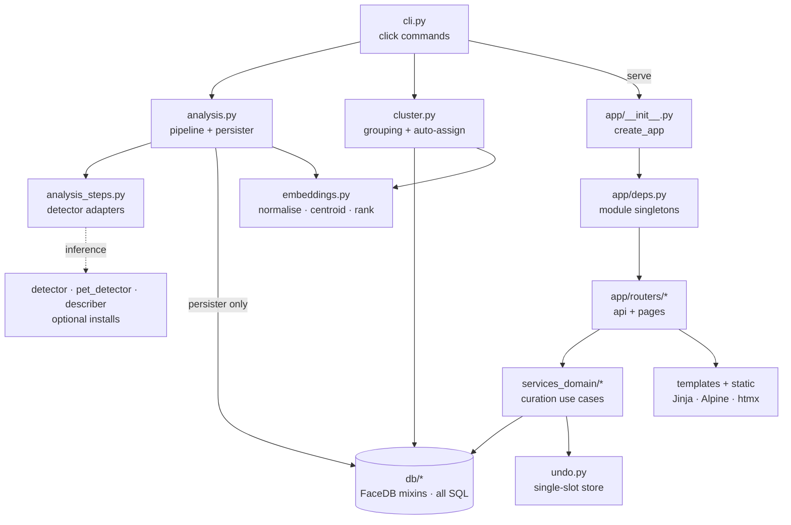

# Architecture

> One package, four layers, and a hard rule that compute never writes: detection builds a value object, a persister writes it, and everything interactive reads the result back out of SQLite.

## Layers and the direction of dependency

Dependencies point one way: entry points → domain → database. Nothing in `db/` imports a service, and nothing in `services_domain/` imports a router.

- **Entry points** — `cli.py` (click) and `app/` (FastAPI). Both own composition and nothing else: which steps to run, which routers to mount, how configuration reaches the rest. `cli.py` is the only place that knows the step set for an analysis run; `app/__init__.py` is the only place that knows the wiring for a request.
- **Domain** — `services_domain/` for curation use cases, `cluster.py` for grouping, `analysis.py` for the ingest pipeline, `undo.py` for the undo slot, `embeddings.py` for vector math. This is where an operation that must be atomic takes a transaction and registers its undo receipt.
- **Database** — `db/`, a `FaceDB` class assembled from one mixin per area over a single shared connection. The only SQL in the project lives here, and reaching around it is treated as a defect.
- **Presentation** — Jinja templates plus Tailwind, Alpine and htmx. No build step for the JavaScript; one standalone binary builds the CSS.

The two load-bearing rules that cut across all of it: **the analysis pipeline never touches the database**¹, and **`/api/...` routes register before the `/{kind}/...` catch-all**². The first makes `--dry-run` and step-level unit tests possible. The second is guarded by a regression test because nothing raises at import time when it is violated — the app simply stops answering JSON on some paths.

## Module map

`routers` reach `db` through `deps` accessors for plain reads; every *mutation* goes through a service so the snapshot, the write and the undo receipt stay together.

## The scan / serve split

The package installs in three profiles, and the profile follows the machine rather than the release:

- **Base** — serve, browse, cluster, auto-assign, auto-merge. No `torch`, no CUDA wheels.
- **Plus detection** — adds InsightFace, ONNX Runtime, Ultralytics, `torch` and SigLIP. Required to analyse.
- **Plus captioning** — adds the MLX VLM. Apple Silicon only, opt-in per run.

The split is real, not cosmetic: the serving box genuinely does not need a gigabyte of model weights. The one crack is manual-finding creation in the web UI, which embeds a user-drawn crop and therefore needs the detection stack on the serving machine too. Platform-specific wheel indexes are selected by environment marker rather than pinned per platform³.

## State and concurrency

One SQLite file, one process, one shared connection. Three mechanisms keep that honest:

- A re-entrant lock wraps database methods, applied by decorator on the mixins⁴.
- `FaceDB.transaction()` makes a snapshot-then-mutate sequence atomic. It is the only thing that does, and nothing asserts its presence.
- A module-level lock serialises every GPU and ANE inference call, because Metal and CoreML reject concurrent command-buffer submissions. Worker threads therefore buy parallel frame I/O and nothing more⁵.

Undo is deliberately a single in-memory slot with a TTL, not a history. A second write clobbers the first token. That is a product decision — the user gets one immediate take-back, not a journal — and it is why the store is transport-agnostic and lives outside both the routers and the database.

## Where things deliberately are not

- **No ORM.** Hand-written SQL behind mixins, and a `Finding` dataclass assembled by a shared JOIN convention.
- **No migration framework.** Schema creation and in-place rebuilds live in the connection module and run on open.
- **No `Depends` graph.** FastAPI's dependency injection is unused; `deps.py` holds module-level singletons behind accessor functions that raise when unconfigured. The trade-off is that `create_app` mutates process-wide state and two apps cannot coexist in one interpreter.
- **No background worker.** Long work is a CLI command a human runs.

## Related decisions

- [`../decisions/ADR-012-architecture-refactor.md`](../decisions/ADR-012-architecture-refactor.md) — the layer and package boundaries, and the vocabulary rule that keeps subject kind out of HTTP
- [`../decisions/ADR-009-unified-analysis-pipeline.md`](../decisions/ADR-009-unified-analysis-pipeline.md) — one pass, N steps, persistence as a separate concern
- [`../decisions/ADR-006-database-design.md`](../decisions/ADR-006-database-design.md) — sources, scans, findings and the curation overlay
- [`../decisions/ADR-011-retire-vlm-default.md`](../decisions/ADR-011-retire-vlm-default.md) — why captioning is opt-in and MLX is the only VLM runtime

## References

¹ `src/ritrova/analysis.py` — `AnalysisPipeline`, `AnalysisPersister`
² `src/ritrova/app/__init__.py` — `create_app`, router include order
³ `pyproject.toml` — optional-dependency extras and the marker-selected wheel indexes
⁴ `src/ritrova/db/_base.py` — `_locked`, `_DBAccessor`
⁵ `src/ritrova/analysis_steps.py` — `_inference_lock`

---

_Last updated: 2026-10-24 by Kipi_
