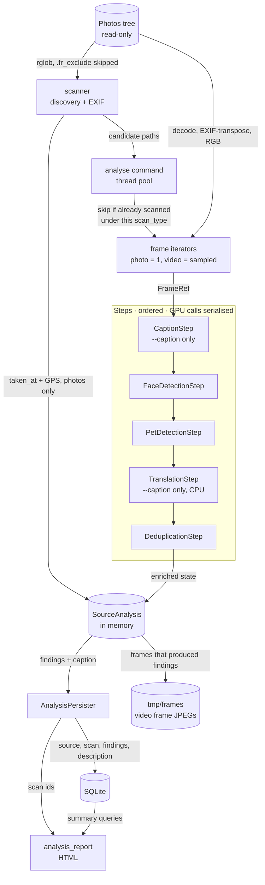

# Analysis Pipeline

> The ingest path: walk the photo tree, run composable detection and captioning steps over every frame, and hand one value object to a persister that does all the writing.

## Modules

- **Source discovery and EXIF**¹ — owns the tree walk for `ritrova analyse` and the EXIF readers. Only `.jpg`/`.jpeg` count as photos; videos are `.mp4`, `.mov`, `.avi`, `.mkv`. A directory holding a `.fr_exclude` marker file drops itself and its subtree. Zero-byte files and anything that fails `stat()` are skipped silently. Out of scope: decoding for analysis, any DB access.
  - Notable: discovery globs each extension in both cases, which double-matches on case-insensitive filesystems, so results are de-duplicated on the lowercased path. EXIF GPS parsing swallows malformed rational tags (zero denominator), because PIL only raises on the float cast deep inside the loop and one bad photo would otherwise kill a whole run².
  - EXIF supplies `taken_at` and lat/lon, and only for photos — videos never get either. Dates shown in the app come from the path parser, which treats EXIF as a last-resort fallback behind directory and filename dates³. EXIF orientation, by contrast, is applied everywhere an image is opened.

- **Pipeline core**⁴ — the value objects (`FrameRef`, `AnalysisFinding`, `SourceAnalysis`), the `AnalysisStep` ABC, the frame iterators, a fluent builder, and `AnalysisPersister`. A step receives one `FrameRef` plus the accumulated `SourceAnalysis` and returns the enriched state; it must not touch the database. The pipeline is pure compute, which is what makes `--dry-run` and step-level unit tests possible.
  - Notable: the pipeline caches a video frame's PIL image the moment *any* step grows `state.findings`, not after all steps have run — dedup can shrink the list back and the net-growth check would miss the frame, leaving a finding row with `frame_path=NULL` whose thumbnail endpoint would then try to PIL-open the `.mp4`⁵.
  - `strategy_id` is the `+`-joined step names and is stored on the scan row, so the step set is recoverable per scan. `CaptionStep` names itself after the VLM model id, so changing models changes the strategy id.
  - Photos are one frame numbered 0; videos yield one `FrameRef` per sampled frame keyed by the real frame index. An unreadable photo yields no frames at all, and the run still records a scan.

- **Persistence boundary**⁶ — `AnalysisPersister` is deliberately not a step. It creates or finds the source row, records one scan, saves cached video frames as JPEGs under the DB's `tmp/frames`, inserts findings batched by `(species, frame_number)`, and stores the caption with its tags. A successful analysis with zero findings still writes a scan row: "looked, found nothing" is information, and it is what keeps the next run from re-scanning the file.
  - Notable: `record_scan` relies on `UNIQUE (source_id, scan_type)` and raises on a second insert, so re-analysis must delete the old scan first — the `analyse --force` path does this⁷. `get_or_create_source` returns an existing row untouched, so dimensions, `taken_at`, GPS and the derived path metadata are written once, at first sight of the file, and never refreshed⁸.
  - Frame JPEG paths are stored relative to the DB directory, which is also how the serving side resolves them.

- **Steps**⁹ — face detection, pet detection, VLM captioning, translation, dedup. Each is a thin adapter: it calls one runtime and converts `Detection` objects into `AnalysisFinding`s, applying its own confidence floor. Face and pet detection run unconditionally; captioning and translation are added only with `--caption`.
  - Notable: a single module-level `threading.Lock` serialises every GPU/ANE call across all steps and all workers. Metal and CoreML do not take concurrent command-buffer submissions, so `--workers > 1` buys parallel frame I/O and nothing else. Translation runs on CPU and deliberately stays outside that lock, which also means its lazy model load is not itself guarded.
  - Captioning and translation act only on frame 0, so a video gets at most one caption, taken from its first sampled frame.
  - Dedup is a whole-source operation implemented as a per-frame step: on every frame it re-runs an O(n²) pairwise comparison over all accumulated findings, grouped by species, keeping the highest-confidence member of each cluster above the similarity threshold. For a photo that is one cheap pass; for a long video it is the same work repeated per frame¹⁰.

- **Model runtimes**¹¹ — `FaceDetector` (InsightFace `buffalo_l`, ONNX Runtime, provider preference CUDA → CoreML → CPU) and `PetDetector` (YOLO for dog/cat boxes, SigLIP for the crop embedding). Both expose a `detect_image` path for an already-loaded PIL image, which is what the pipeline uses, and a file-path path used by scripts. Both also expose `embed_crop` for a user-drawn box, so the web app needs these runtimes too, not just the CLI.
  - Notable: face detection rejects boxes under 50 px and blurry crops via a Laplacian-variance threshold that scales *down* with face area, so large smooth faces are not mistaken for blur. Embedding dimension is the species discriminator downstream: 512 for ArcFace, 768 for SigLIP.
  - Pet detection picks its YOLO device defensively — CUDA torch paired with a CPU-only torchvision falls back to CPU rather than failing inside NMS. SigLIP goes to CUDA, then MPS, then CPU, chosen independently of the YOLO device.

- **Captioning**¹² — `Describer` (MLX VLM, English caption plus English tags, parsed from JSON with a line-based fallback) and `Translator` (MarianMT en→it, greedy decode, caption and tags sent as one block so the tags give the caption context). Apple Silicon only: a non-ARM Darwin host raises at model-load time, and `analyse --caption` checks the platform before building the pipeline. Both load lazily and are documented as thread-unsafe.
  - Notable: this module also holds `describe_sources`¹³, the standalone `ritrova describe` back-fill. It writes to the DB directly, bypassing the pipeline and the persister, under its own `describe` scan type, and refreshes the tag vocabulary hint every few hundred sources.

- **Run orchestration**¹⁴ — the `analyse` command owns everything the pipeline is not allowed to know: which steps to compose, the effective `scan_type` label (`subjects`, or `subjects+captions`), discovery versus explicit-paths mode, skipping sources already scanned under that label, sampling, the thread pool, the shared counters, and the `--profile` buckets split by source type. It also owns the destructive-rescan confirmation: `--force` on explicit paths counts the findings and the manual assignments it is about to delete and asks first.
  - Notable: per-source failure handling catches `OSError` only, around frame iteration and the pipeline. Anything else propagates out of the worker and aborts the run on `future.result()`.

- **Run report**¹⁵ — `write_analysis_report` renders a self-contained HTML summary for a set of scan ids: per-source species counts, clustering coverage, assigned subjects, exclusion reasons, and subjects that are *likely* present because a new finding landed in a cluster that already holds named peers. Read-only, raw SQL, no dependency on the pipeline.

- **Shared vector math**¹⁶ — normalisation, centroids and cosine ranking live in one tiny module used by both the ingest and the clustering sides. Embeddings are stored L2-normalised, so a dot product is cosine similarity throughout. `hints.py` builds on it to score a cluster or a lone finding against subject centroids for the web UI; it belongs to [`../05-clustering-assignment/`](../05-clustering-assignment/). Image resizing and crop thumbnails (`images.py`) are the serving side, under the same EXIF-transpose convention; see [`../06-web-app/`](../06-web-app/).

## Data flow

## Operational notes

- Detection needs the `scan` extra (InsightFace, ONNX Runtime, Ultralytics, torch, SigLIP via transformers); captioning needs `caption` on top (mlx-vlm), and that one is Apple-Silicon-only. The base install serves and clusters but cannot analyse — and cannot embed a hand-drawn box in the web UI either.
- Progress, ETA and the profile table go to stdout via `print`, not the logger; third-party loggers are forced to ERROR during model loading because they are otherwise unreadable.
- `--interval` controls video frame sampling. Raising it loses brief appearances; the default is deliberately conservative.
- Video frame JPEGs under the DB's `tmp/frames` are a regenerable cache, not source data. Finding rows point at them by relative path, so deleting the directory breaks video thumbnails until it is rebuilt.
- `--scan-type` exists so an experiment can write a parallel set of scans beside the production ones without the skip logic conflating them.

## Related decisions

- [`../decisions/ADR-009-unified-analysis-pipeline.md`](../decisions/ADR-009-unified-analysis-pipeline.md) — one pass, N steps, persistence as a separate concern
- [`../decisions/ADR-001-face-detection-model.md`](../decisions/ADR-001-face-detection-model.md) — InsightFace `buffalo_l`
- [`../decisions/ADR-004-pet-detection-pipeline.md`](../decisions/ADR-004-pet-detection-pipeline.md) — YOLO plus SigLIP
- [`../decisions/ADR-005-video-face-extraction.md`](../decisions/ADR-005-video-face-extraction.md) — frame sampling and per-video dedup
- [`../decisions/ADR-008-scene-descriptions-vlm.md`](../decisions/ADR-008-scene-descriptions-vlm.md) — captions and tags
- [`../decisions/ADR-010-analyse-performance-optimization.md`](../decisions/ADR-010-analyse-performance-optimization.md) — profiling, the serialisation limit, token and image-size budgets
- [`../decisions/ADR-011-retire-vlm-default.md`](../decisions/ADR-011-retire-vlm-default.md) — captioning opt-in, MLX as the only VLM runtime, detection always on
- [`../decisions/ADR-006-database-design.md`](../decisions/ADR-006-database-design.md) — sources, scans and findings

## References

¹ `src/ritrova/scanner.py` — `find_images`, `find_videos`, `EXCLUDE_MARKER`
² `src/ritrova/scanner.py` — `get_exif_gps`, `get_exif_date`
³ `src/ritrova/db/path_metadata.py` — `parse_source_path_metadata`
⁴ `src/ritrova/analysis.py` — `SourceAnalysis`, `AnalysisStep`, `AnalysisPipelineBuilder`
⁵ `src/ritrova/analysis.py` — `AnalysisPipeline.analyse_source`
⁶ `src/ritrova/analysis.py` — `AnalysisPersister`
⁷ `src/ritrova/db/scans.py` — `record_scan`, `delete_scan`
⁸ `src/ritrova/db/sources.py` — `get_or_create_source`, `add_source`
⁹ `src/ritrova/analysis_steps.py` — `_inference_lock`, `FaceDetectionStep`, `PetDetectionStep`, `CaptionStep`, `TranslationStep`
¹⁰ `src/ritrova/analysis_steps.py` — `DeduplicationStep`
¹¹ `src/ritrova/detector.py` — `FaceDetector`; `src/ritrova/pet_detector.py` — `PetDetector`; `src/ritrova/detection.py` — `Detection`, `DetectionResult`
¹² `src/ritrova/describer.py` — `Describer`, `Translator`, `_parse_vlm_response`
¹³ `src/ritrova/describer.py` — `describe_sources`
¹⁴ `src/ritrova/cli.py` — `analyse`
¹⁵ `src/ritrova/analysis_report.py` — `write_analysis_report`
¹⁶ `src/ritrova/embeddings.py` — `normalize`, `compute_centroid`, `rank_by_similarity`; `src/ritrova/hints.py` — subject-centroid hints

---

_Last updated: 2026-10-24 by Kipi_
