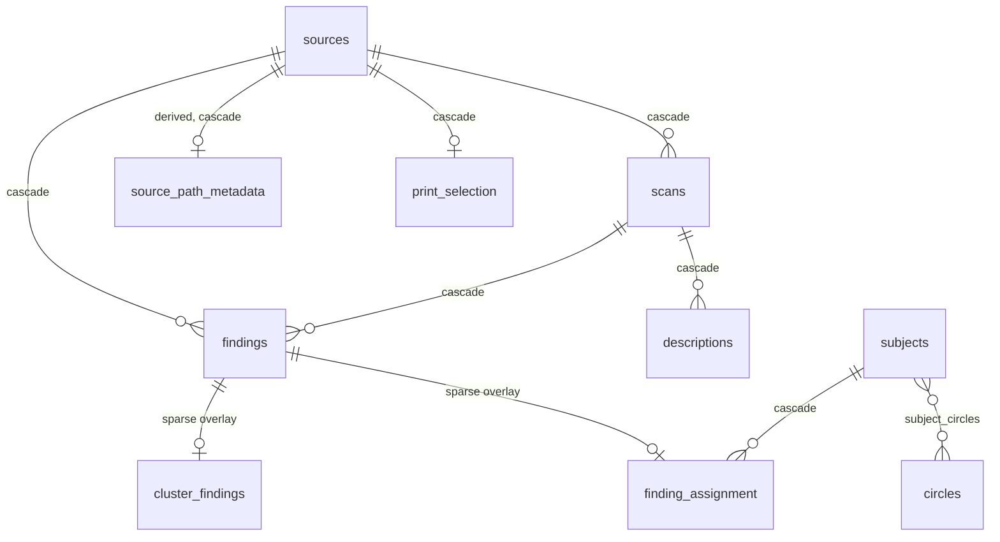

# Data Model and Database Layer

> One SQLite file holds the whole archive: immutable detector output, the user's curation on top of it, and metadata derived from file paths — with the rules that keep the three layers from corrupting each other.

The schema itself lives in one place and is readable with `.schema`¹. This chapter covers only what the schema does not say.

## Schema-wide conventions

**Detector output is immutable; curation is a sparse overlay.** `findings` rows carry bbox, embedding, species, confidence and nothing the user can change. Everything the user authors lives in two side tables keyed one-to-one on `finding_id`: `cluster_findings` (membership) and `finding_assignment` (naming or exclusion)¹. Both are sparse — **absence of a row is the default state**, not a row with NULLs⁵. "Unclustered" means no `cluster_findings` row. "Uncurated" means no `finding_assignment` row.

**`finding_assignment` is an XOR.** A row holds either `subject_id` or `exclusion_reason` (`stranger` / `not_a_face`), never both, never neither — a CHECK constraint enforces it¹. Python sees the two as sibling Optionals on `Finding`; `Finding.curation` reifies them as a `Uncurated | AssignedTo | Excluded` union so a `match` gets exhaustiveness⁶. Curation writes are `INSERT OR REPLACE`, so naming an excluded finding silently unmarks it, and excluding a named finding silently drops the name⁵. Two paths sidestep that: subject merge repoints rows with an `UPDATE`⁸, and the schema rebuild inserts with `OR IGNORE`¹.

**Reads go through one JOIN convention.** `_FINDING_COLUMNS` + `_FINDING_FROM` LEFT JOIN both side tables and alias their columns back onto the `Finding` dataclass fields⁴. Every query that materialises findings composes these two constants, including the ones that only need `(finding_id, source_id)` stubs. A query that reaches `findings` directly will report every finding as uncurated and unclustered.

**`species` partitions the model; `kind` is the subject-level mirror.** `findings.species` is the detector's class (`human`, `dog`, `cat`, `other_pet`); `subjects.kind` is singular (`person`, `pet`); URLs and templates use plural `kind` (`people`, `pets`). `"pet"` is a *filter token*, never a stored species: `species_filter` expands it to the pet tuple, so one call covers all three animal classes⁷. Assignment validates compatibility (`human`→`person`, pet classes→`pet`) and refuses a mismatch unless `force=True`; species is never rewritten to match the subject⁸.

**Embedding space is implied by species and must be filtered explicitly.** Embeddings are raw `float32` `.tobytes()` BLOBs with `embedding_dim` stored alongside; reads use `np.frombuffer`⁴. Human faces are 512-dim (ArcFace), pets 768-dim (SigLIP). Nothing in the schema prevents mixing them in one query, so every similarity or centroid read takes an `embedding_dim` filter and the caller is expected to pass the right one⁷ ¹⁰.

**Cluster ids are bare integers with no owning table.** `cluster_findings.cluster_id` references nothing. A clustering run clears only its own species' memberships, then offsets its fresh labels past the global `MAX(cluster_id)` so the two species cannot collide¹⁰. A split allocates `MAX+1` the same way⁹. Consequence: cluster ids are not stable across runs and must not be stored anywhere durable.

**Paths are stored relative and resolved at read time.** `sources.file_path` is relative to `base_dir` (the photo library root, supplied per process) and is the UNIQUE identity of a source. `resolve_path` rejects `..`, treats a leading `/` as already absolute, and resolves `tmp/`-prefixed app-generated paths against the *database* directory instead⁷. Video frame JPEGs (`findings.frame_path`) are always database-relative⁷ ²¹. Per the project rule, the path — not EXIF — is the date of record: `source_path_metadata` parses it and `sources.taken_at` is only a fallback¹¹.

**Timestamps are UTC ISO-8601 TEXT, written only from Python.** `_now()` is the single producer; no column has a SQL default for time, so a raw `INSERT` from outside the app leaves them empty¹. Dates derived from paths are a different thing entirely: `date_text` is variable-precision (`YYYY`, `YYYY-MM`, `YYYY-MM-DD`) and range filters compare it lexicographically¹¹ ¹².

**Tag sets are colon-sentinel strings.** `descriptions.tags` and `source_path_metadata.path_tags` both encode a set as `:a:b:c:`, matched with `LIKE '%:tag:%'` for exact-token search¹¹ ¹³. Path tags are also normalised (lowercased, accents stripped, noise words such as `img`/`dsc`/`whatsapp` dropped), and user-entered filters must go through the same `normalize_path_tag` to match¹¹.

**`ON DELETE CASCADE` everywhere a child cannot outlive its parent**: source → scans, findings, descriptions, path metadata, print selection; scan → findings, descriptions; finding → assignment, cluster membership; subject → assignment rows; circle → memberships¹. Two consequences worth internalising: deleting a *scan* destroys the curation attached to its findings, and deleting a *subject* returns its findings to uncurated rather than leaving dangling ids. Cascade depends on `PRAGMA foreign_keys=ON`, which the app sets on every connection — an outside `sqlite3` CLI does not, which is the only way orphans appear¹⁸.

## Modules

- **Connection, schema and transactions**¹ ² ³ — `FaceDB` is one object assembled from mixins over a single shared `sqlite3` connection (WAL, `check_same_thread=False`, FKs on). It owns the full schema, the forward-only migrations, and the `scan_types` catalog.
  - Notable: **every mixin method commits on its own**. Atomicity across several calls is the caller's job, via `FaceDB.transaction()` — it takes the reentrant lock, issues `BEGIN IMMEDIATE`, and sets a flag on a `sqlite3.Connection` subclass that neutralises the inner `commit()` calls for the duration². Nested `transaction()` calls reuse the outer one. The domain services use this to make snapshot-then-mutate pairs atomic, which is what makes undo snapshots trustworthy²⁰.
  - Notable: all state is serialised by one `threading.RLock` via `@_locked`³. Several read methods and a few write helpers are *not* decorated and touch the connection directly, so the lock is a convention rather than a guarantee.
  - Notable: mixins call across each other freely; `_DBAccessor` declares stub signatures purely so those cross-calls type-check³. MRO order in the `FaceDB` declaration is therefore load-bearing for nothing but readability — no mixin overrides another.

- **Detection record: sources, scans, findings**¹⁶ ²³ ⁴ — a `source` is a photo or video file, identified by its path. A `scan` is one pipeline run over one source, `UNIQUE (source_id, scan_type)`; `findings` hang off both the source and the scan.
  - Notable: `scans.scan_type` is a *logical* FK to the documentation-only `scan_types` table, resynced from a code constant on every DB open. Retired pipelines keep their row so historic scans stay explainable²².
  - Notable: `record_scan` has no upsert — callers must gate on `is_scanned()` and `delete_scan()` before a rescan, or hit the UNIQUE constraint¹⁶.
  - Notable: `findings.scan_id` is NOT NULL, enforced through a table rebuild because SQLite cannot alter a column's nullability. The rebuild runs with FKs off so that dropping `findings` does not cascade-wipe the side tables, and it refuses to run while any row is still NULL¹.
  - Notable: the write path for a whole analysed source — source, scan, frame JPEGs, findings grouped by `(species, frame_number)`, optional description — is a sequence of independent commits in the persister, not one transaction²¹.

- **Curation and clustering state**⁵ ⁹ ¹⁷ — the write API for `finding_assignment` and `cluster_findings`, plus the queries the curation UI runs on top (unnamed clusters, singletons, "photos with all of these subjects").
  - Notable: writes that must land together, and so belong inside one `transaction()`: dismissing a finding (set `not_a_face` **and** drop cluster membership)¹⁷, marking a cluster as strangers, and every snapshot-then-mutate pair behind an undo token²⁰.
  - Notable: "reviewable unnamed cluster" has exactly one definition — clusters of size ≥ 2 where *no* finding has an assignment row. Both the list and the dashboard count read the same query so the two cannot drift⁹.
  - Notable: assigning a cluster to a subject touches only its uncurated findings; previously excluded ones are deliberately left excluded⁸.
  - Notable: cluster ordering is "newest photo first", computed in Python from `YYYY-MM` in the path with `taken_at` as fallback, because the dates are TEXT and the paths are not parseable in SQL⁹.

- **Subjects and circles**⁸ ¹⁵ — named people and pets, `UNIQUE (name, kind)`, created idempotently by name. `face_count` is never stored; it is always a `COUNT` over `finding_assignment`. Circles are user-defined labelled groups of subjects, joined through `subject_circles`, used mainly to *exclude* subjects from photo views.
  - Notable: a merge is `UPDATE finding_assignment SET subject_id` plus a `DELETE` of the source subject. The merged-in findings can then collide on `(source_id, subject_id)`, which is what the prune command cleans up¹⁷.

- **Path-derived metadata and source search**¹¹ ¹² — a pure parser extracts a date (with precision and provenance) and a tag set from a source path, and a one-row-per-source table caches the result. Conflict policy is fixed: directory date beats filename date when they disagree or when the filename looks like a `01-01` placeholder; otherwise the more precise one wins; EXIF is last.
  - Notable: the row is written on source creation and only backfilled for sources that have none — a path change does not invalidate it¹¹.
  - Notable: `search_sources` is the single composable surface for subject + tag + date + type filtering; `/together` is one caller of it, not a separate implementation¹².

- **Captions and the print worklist**¹³ ¹⁴ — `descriptions` holds one VLM caption and tag set per scan, read as "most recent per source". `print_selection` is a one-row-per-source ordered worklist with a UNIQUE index on `position`.
  - Notable: because `position` is unique, a reorder cannot write the new positions directly — it first negates them all, then writes the final values, inside one transaction¹⁴.

- **Undo support**¹⁹ ²⁰ — **nothing about undo is persisted.** A single in-memory, TTL-bounded slot holds one payload at a time²⁰. The DB layer only supplies the snapshot reads (prior `subject_id` / `cluster_id` per finding, a full `subjects` row) and the inverse writes.
  - Notable: a deleted subject is resurrected with its original id. This is safe only because `AUTOINCREMENT` never reuses ids, so no live row can occupy the freed one¹⁹.
  - Notable: snapshots are plain tuples, so a snapshot taken outside the mutation's transaction can be stale. The services avoid this by wrapping both in `transaction()`; an undo payload's own `undo()` does not, and may apply its two or three writes non-atomically²⁰.

- **Maintenance**¹⁸ ¹⁷ — orphan detection and deletion, species-scoped stats, JSON export, and duplicate-finding pruning (same subject or same cluster twice on one source).

## Data flow

Left of `findings` is detector output, written once per scan. Right of it is user intent, written one row at a time and freely deleted. `cluster_findings` is machine-written but user-editable; `finding_assignment` is user-only.

## Operational notes

- Migrations are forward-only and run on **every** `FaceDB(...)` construction: `ALTER TABLE ... ADD COLUMN` statements with `OperationalError` suppressed, then idempotent data migrations guarded by existence probes¹. There is no version table and no down path. Opening the DB is therefore not a read-only act.
- `PRAGMA foreign_keys` is per-connection. Any delete issued from `sqlite3` CLI, a GUI or an ad-hoc script skips the cascade and leaves children behind. `ritrova` has a find-and-delete-orphans command for exactly this¹⁸.
- `FaceDB.run` / `FaceDB.query` are the escape hatch for ad-hoc SQL and bypass every convention above — notably the curation JOINs and the species filter¹.
- WAL mode plus a single shared connection means readers never block, but the writer is global: a long clustering or analysis run serialises every web write behind it.
- Deleting a scan is the destructive operation to be careful with: it cascades to findings and therefore to curation. `delete_scan` returns how many of the doomed findings carried a subject assignment so a caller can warn first¹⁶.

## Related decisions

- [`../decisions/ADR-006-database-design.md`](../decisions/ADR-006-database-design.md) — SQLite, WAL, shared connection, RLock, forward-only migrations.
- [`../decisions/ADR-012-architecture-refactor.md`](../decisions/ADR-012-architecture-refactor.md) — the split of curation state off `findings`, and the per-layer `species` / `kind` vocabulary rule.
- [`../decisions/ADR-009-unified-analysis-pipeline.md`](../decisions/ADR-009-unified-analysis-pipeline.md) — one scan per source covering faces and pets together.
- [`../decisions/ADR-005-video-face-extraction.md`](../decisions/ADR-005-video-face-extraction.md) — why video findings carry a `frame_path` and a `frame_number`.
- [`../decisions/ADR-002-clustering-algorithm.md`](../decisions/ADR-002-clustering-algorithm.md) — what produces `cluster_findings`.

## References

¹ `src/ritrova/db/connection.py` — `FaceDB._create_tables`, migration helpers
² `src/ritrova/db/connection.py` — `_TransactionalConnection`, `FaceDB.transaction`
³ `src/ritrova/db/_base.py` — `_locked`, `_DBAccessor`
⁴ `src/ritrova/db/findings.py` — `_FINDING_COLUMNS`, `_FINDING_FROM`, `_row_to_finding`, `FindingMixin`
⁵ `src/ritrova/db/assignments.py` — `AssignmentMixin`
⁶ `src/ritrova/db/models.py` — `Curation`, `Finding.curation`, `OrphanReport`
⁷ `src/ritrova/db/paths.py` — `PathMixin`
⁸ `src/ritrova/db/subjects.py` — `SubjectMixin`
⁹ `src/ritrova/db/clusters.py` — `ClusterMixin`
¹⁰ `src/ritrova/cluster.py` — `cluster_faces`, `EMBEDDING_DIMS`
¹¹ `src/ritrova/db/path_metadata.py` — `parse_source_path_metadata`, `PathMetadataMixin`
¹² `src/ritrova/db/source_search.py` — `SourceSearchMixin`
¹³ `src/ritrova/db/descriptions.py` — `DescriptionMixin`
¹⁴ `src/ritrova/db/print_selection.py` — `PrintSelectionMixin`
¹⁵ `src/ritrova/db/circles.py` — `CirclesMixin`, `Circle`
¹⁶ `src/ritrova/db/scans.py` — `ScanMixin`
¹⁷ `src/ritrova/db/curation.py` — `CurationMixin`, `PruneReport`
¹⁸ `src/ritrova/db/maintenance.py` — `MaintenanceMixin`
¹⁹ `src/ritrova/db/undo_support.py` — `UndoMixin`
²⁰ `src/ritrova/undo.py` — `UndoStore`, `UndoPayload` subclasses
²¹ `src/ritrova/analysis.py` — `AnalysisPersister`
²² `src/ritrova/db/connection.py` — `KNOWN_SCAN_TYPES`, `_sync_scan_types`
²³ `src/ritrova/db/sources.py` — `SourceMixin`

---

_Last updated: 2026-10-24 by Kipi_
