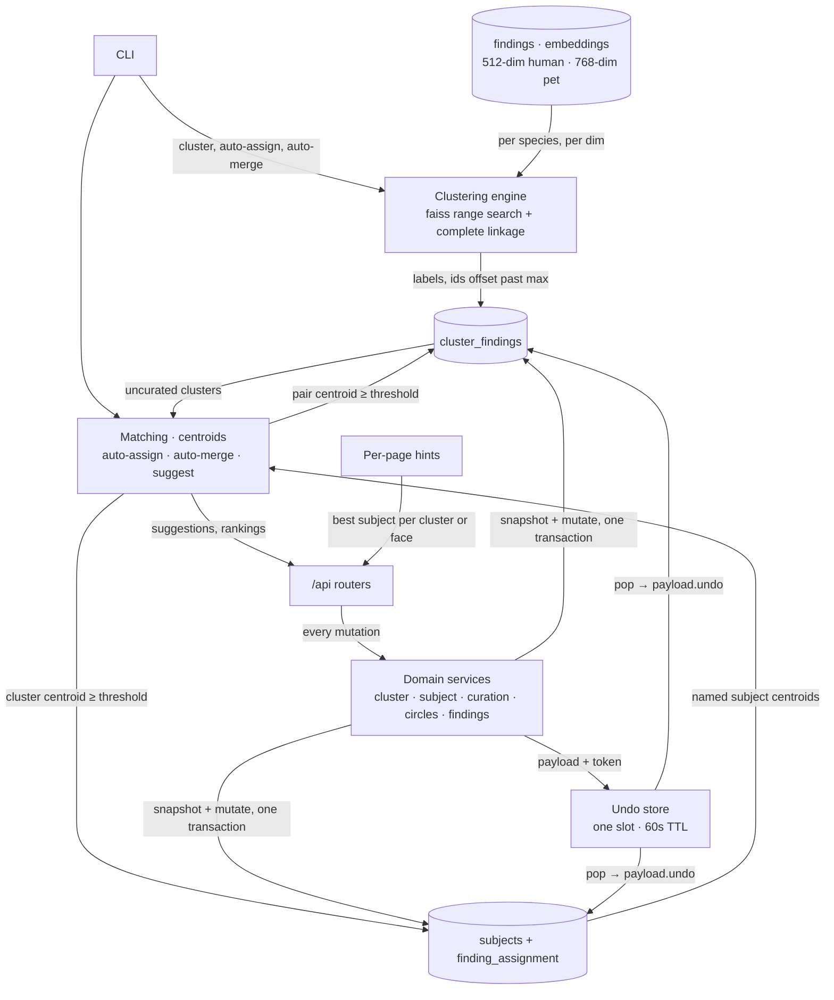

# Clustering and Assignment

> How face and pet embeddings become clusters, how clusters become named subjects, and how every one of those writes stays undoable.

## Modules

- **Clustering engine**¹ — owns the batch pass that turns stored embeddings into cluster memberships. Two-phase algorithm (ADR-002): a faiss `IndexFlatIP` range search finds candidate neighbour pairs, BFS over the resulting adjacency gives connected components, then exact complete-linkage hierarchical clustering runs inside each component. The second phase exists only to kill chaining: connected components are single-linkage, complete linkage is not. In scope: membership of the `cluster_findings` rows. Out of scope: detection, embedding, and any subject assignment.
  - `IndexFlatIP` over L2-normalized vectors is cosine similarity. The engine takes a cosine **distance** threshold and converts it to a similarity floor of `1 - threshold`. Every other function in this chapter takes a cosine **similarity**, and the CLI and HTTP layers take a **percentage**. Three units for one quantity — check which one a call site means.
  - Species are clustered in separate passes and separate vector spaces (512-dim ArcFace for humans, 768-dim SigLIP for pets). New cluster ids are offset past the current global maximum, so ids stay unique across species. A run clears only its own species' memberships; subject assignments live in another table and are never touched.
  - Faces below `min_size` in a component become noise (label `-1`) and get no cluster row. The same `-1` doubles as the BFS "not visited" marker, so noise is reachable from a later BFS start.
  - Components above ~500 faces are first split by faiss k-means into roughly 300-face groups, then verified per group. This caps the `pdist` matrix instead of materialising n×n at 61K faces, which is the memory wall ADR-002 was written against.

- **Matching and ranking**² — centroid-based read paths plus the two bulk writes built on them. A centroid is the L2-normalized mean of a group's embeddings, computed fresh from DB rows on every call; nothing is cached. `auto_assign` matches each unnamed cluster centroid against every named subject centroid and assigns the whole cluster when the best match clears the threshold, then sweeps unclustered singletons the same way. `auto_merge_clusters` consumes the merge-suggestion list and folds the smaller cluster into the larger one. Read-only siblings rank subjects for one cluster, find the next similar cluster for navigation, find similar unclustered faces for a subject, and compare two subjects to surface probable misassignments.
  - Kind is derived from the embedding **length**, not from the `species` label, wherever a centroid already exists. A finding's species can be corrected by a user while its vector stays in the space the original detector used, so the label is not a reliable key into the vector space.
  - `suggest_merges` pools named subjects and unnamed clusters into one list and scores every pair, O(groups²) in centroid space. Subject-to-subject pairs are skipped: two named subjects are different people on purpose. So a suggestion is always cluster↔cluster or cluster↔subject.
  - `auto_merge_clusters` computes the full suggestion list once and then merges from that snapshot, so sizes and memberships go stale inside the loop. The CLI compensates by re-running passes until no merge happens.
  - Cost at 61K faces is dominated by centroid rebuilds, not by the matrix multiply: `suggest_merges` loads up to 500 embeddings per group for every subject and every unnamed cluster on each call, and the merge UI calls it per page render.

- **Per-page hints**³ — pure functions that answer "who is this probably?" for one cluster or for a page of singleton faces, using the same centroid math. Kept separate from the engine because they mutate nothing and are called from render paths. They import the engine's private centroid helper, so the two move together.

- **Domain services**⁴ — the coordinator layer between routers and `FaceDB`. One service per aggregate: clusters (merge, split, assign), subjects (create, rename, delete, merge, claim-faces, swap), curation (dismiss, mark-stranger, unassign, exclude-from-cluster), circles (named groups of subjects, with membership), findings (user-drawn bounding box to a new finding row). Every mutating method follows the same shape: snapshot prior state and mutate inside one `FaceDB.transaction()`, register an undo payload, return an `UndoReceipt`. In scope: orchestration and the human-facing message. Out of scope: SQL — there is no repository layer, `FaceDB` stays the SQL boundary, and there is no caching or ORM.
  - The invariant every write keys on is **uncurated = no `finding_assignment` row**. Cluster naming, cluster assign and mark-stranger all touch uncurated findings only, so an earlier decision by the user is never silently overwritten.
  - `SpeciesMismatch`⁵ (a `ValueError` subclass) is raised when a finding's species cannot belong to the target subject's kind. Routers turn it into `409 {error, needs_confirm: true}`; the client re-posts with `force=true`. This check lives in the services, not in the routers.
  - A method returns `None` instead of a receipt when the write was a no-op (empty selection, already a circle member, nothing uncurated left). Non-undoable writes — subject create, rename, circle create — also return `None`, by decision, because the UI already offers the obvious inverse.
  - Age splitting is a non-feature here, and deliberately so (ADR-003): nothing in the pipeline is age-aware. Baby faces land in their own clusters because their embeddings sit in their own region, and the user merges them by hand once per person. The cost is a diluted centroid for anyone spanning baby to adult, which lowers auto-assign accuracy for that person.

- **Undo store**⁶ — one in-memory slot for the whole app, 60-second TTL, guarded by a lock. Not one step per entity: **one step total**. A second write clobbers the pending token, a `pop` is one-shot, and an expired entry is dropped on the next `pop` or `peek`. The store is transport-agnostic; a payload is a dataclass with a single `undo(db)` method.
  - A payload must carry everything needed to invert the write, because the DB keeps no history. That means per-finding prior `(subject_id, cluster_id)` snapshots for anything that moves findings, and a full row snapshot for anything that deletes a subject or circle.
  - Some inverses lean on `ON DELETE CASCADE` rather than snapshots: undoing a cluster naming just deletes the new subject, and undoing a manual finding just deletes the row. Both drop the child assignment rows with it.
  - Two inverses are not exact. Resurrecting a circle gives it a **new id**, since the old one is gone. Restoring findings from "stranger" needs explicit ids, because the DB forgets which cluster a stranger-marked finding came from; called without them it restores every current stranger into the given cluster.
  - Resurrecting a subject runs its two DB calls as separate transactions. A crash between them leaves the subject with no findings; re-running undo fixes it, since the second call is idempotent.
  - The store dies with the process. Undo is a toast-lifetime affordance, not an edit history.

## Data flow

## Operational notes

- `ritrova cluster` runs every species in one go with per-species distance thresholds, then runs auto-merge to convergence (capped at 20 passes). Human and pet thresholds are far apart: humans tolerate a loose cosine distance, pets need a much tighter one because SigLIP embeddings are dense.
- Pet auto-merge is **disabled by setting its threshold above 100%**. SigLIP embeds "a cat", not "this cat": any two cats' centroids sit around 0.92–0.98 cosine similarity, so any reachable threshold cascades every pet into one mega-cluster. Pets rely on manual curation and the merge-suggestion UI instead.
- `ritrova auto-assign` and `ritrova auto-merge` take `--min-similarity` as a percentage and divide by 100. They take `--kind` (person/pet), not species, and map to species internally.
- The clustering function's own default threshold differs from the one the CLI passes. The CLI value is the operational one.
- Thresholds in practice: auto-assign assigns at a fairly permissive similarity, which ADR-007 flags as the main false-assignment risk in a household of lookalikes. The merge-suggestion feed defaults much lower still — it is a ranked list for a human to judge, not a decision.
- Auto-assign is non-destructive and incremental: it only reads unnamed clusters and uncurated singletons, so it can be re-run after every naming session and will pick up the newly named subjects.
- Re-clustering a species wipes that species' cluster memberships but keeps all subject assignments, so naming work survives a re-cluster. Curation that drops cluster rows (dismiss, mark-stranger) hides those findings from clustering, auto-assign and merge suggestions, while leaving them visible on their source photo.
- `faces_moved` and `assigned_faces` counters in the auto-merge and auto-assign results come from snapshots taken before the writes. Treat them as progress indicators, not as audits.

## Related decisions

- [`../decisions/ADR-002-clustering-algorithm.md`](../decisions/ADR-002-clustering-algorithm.md) — the two-phase faiss plus complete-linkage design and its complexity
- [`../decisions/ADR-003-person-age-splitting.md`](../decisions/ADR-003-person-age-splitting.md) — why no age logic exists and why babies cluster separately
- [`../decisions/ADR-007-auto-assign-workflow.md`](../decisions/ADR-007-auto-assign-workflow.md) — centroid matching instead of re-clustering
- [`../decisions/ADR-004-pet-detection-pipeline.md`](../decisions/ADR-004-pet-detection-pipeline.md) — the SigLIP embedding space that forces separate pet thresholds
- [`../decisions/ADR-006-database-design.md`](../decisions/ADR-006-database-design.md) — the tables this chapter writes; see also [`../04-data-model/`](../04-data-model/)
- [`../decisions/ADR-012-architecture-refactor.md`](../decisions/ADR-012-architecture-refactor.md) — the domain-service layer, the receipt contract, and one transaction per mutation

## References

¹ `src/ritrova/cluster.py` — `cluster_faces`, `_cluster_faiss`, `_cluster_exact`, `_cluster_exact_or_split`, `EMBEDDING_DIMS`
² `src/ritrova/cluster.py` — `auto_assign`, `auto_merge_clusters`, `suggest_merges`, `MergeSuggestion`, `rank_subjects_for_cluster`, `find_similar_cluster`, `find_similar_unclustered`, `compare_subjects`, `nearest_named_subject`, `_findings_centroid`
³ `src/ritrova/hints.py` — `compute_cluster_hint`, `compute_singleton_hints`
⁴ `src/ritrova/services_domain/` — `ClusterService`, `SubjectService`, `CurationService`, `CirclesService`, `FindingsService`
⁵ `src/ritrova/services_domain/receipts.py` — `UndoReceipt`, `SpeciesMismatch`, `UndoToken`
⁶ `src/ritrova/undo.py` — `UndoStore`, `UndoPayload` and its concrete payloads
⁷ `src/ritrova/cli.py` — `cluster`, `auto_assign`, `auto_merge` commands, `SPECIES_THRESHOLDS`, `AUTO_MERGE_THRESHOLDS`
⁸ `src/ritrova/app/routers/clusters.py` — merge-suggestion feed and cluster mutation endpoints
⁹ `src/ritrova/app/routers/undo.py` — `peek` and `pop` endpoints
¹⁰ `src/ritrova/db/subjects.py` — `get_subject_centroids`, `assign_cluster_to_subject`, `merge_subjects`
¹¹ `src/ritrova/db/clusters.py` — `get_unnamed_clusters`, `merge_clusters`, `split_cluster_findings`, `clear_clusters`
¹² `src/ritrova/embeddings.py` — `compute_centroid`, `cosine_similarity`, `normalize`

---

_Last updated: 2026-10-24 by Kipi_
