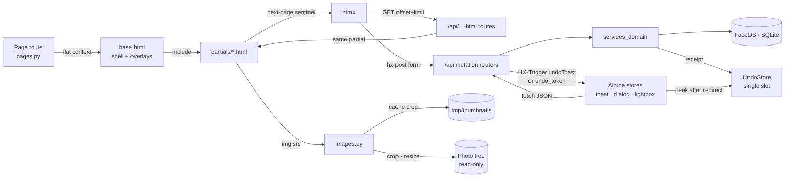

# Web Application

> The served half of Ritrova: a FastAPI app that renders Jinja curation pages, answers htmx fragment and JSON calls over the same `FaceDB`, and streams crops and originals out of the read-only photo tree.

## Route map and the ordering invariant

Four families, in registration order¹:

| Family | Examples | Returns |
|---|---|---|
| Static mount | `/static/...` | files |
| `/api/<aggregate>/...` | findings, clusters, subjects, circles, print-selection, undo, sources | JSON, or a 303 to the next review item |
| `/api/....-html` | `faces-html`, `findings-html`, `browse-html`, `together-html`, `merge-suggestions-html`, `hint-html`, `singletons/faces-html` | one Jinja partial |
| Pages | `/`, `/photos/{id}`, `/clusters/{id}`, `/circles`, `/browse`, `/together`, `/print`, then `/{kind}/...` | full pages |

**`pages` is registered last, and that is an invariant, not a preference.**¹ ⁴ Starlette picks the first route whose *path pattern* matches and never backtracks. `kind` is typed `Literal["people", "pets"]`, but that type is validated inside the endpoint — after the match is already committed. So a two-segment `/api/...` route registered after `pages` would be captured by `/{kind}/{subject_id}`, fail validation, and answer 422 instead of JSON. Nothing raises at import time; the app simply stops speaking JSON on some paths. A regression test guards both halves of this: the index of the last `/api/` route must precede the first `/{kind}` route, and a live GET for a missing finding must come back as JSON 404³.

Inside `pages`, the fixed-prefix pages (`/photos/...`, `/clusters/...`, `/circles/...`) are declared before the `/{kind}/...` block for the same reason, and the most specific `/{kind}/...` patterns before the bare `/{kind}`⁴.

## Modules

- **Assembly** (`app/__init__.py`)¹ — `create_app(db_path, photos_dir)` builds the `FaceDB` and the `UndoStore`, derives the thumbnail cache directory from the DB path, creates `Jinja2Templates`, and hands all four to `deps.configure` in one call. Then it mounts `/static` and includes the routers in the load-bearing order. The undo store is also parked on `app.state`; the comment there says tests use it, but nothing reads it — isolation comes from building a fresh app per test.
  - Notable: there is one configure step and one place that knows the wiring. Routers import accessors, never the app.

- **Dependency wiring** (`app/deps.py`)² — module-level singletons behind `get_db` / `get_undo_store` / `get_templates` / `get_thumbnails_dir` and one accessor per domain service (curation, subject, cluster, circles, findings). Each accessor raises `RuntimeError` when unconfigured, so using a router outside `create_app` fails with a clear message instead of an `AttributeError` on `None`. FastAPI's `Depends` is deliberately absent.
  - Notable: `configure` writes process-wide globals. Tests swap dependencies by calling `create_app` again — the last call wins for the whole process, so two apps cannot coexist in one interpreter.

- **Vocabulary and shared helpers** (`app/helpers.py`)⁵ — the HTTP layer holds exactly two vocabularies: the plural URL `kind` (`people`/`pets`) and the finding `species` (`human`/`dog`/`cat`/`other_pet`). `species_for_kind` maps `pets` to the umbrella value `pet`, which `FaceDB` expands into the concrete pet species. `kind_for_species` goes back, but it tests against `pet`/`cat`/`dog` only, so `other_pet` falls through to `people`; no detector writes that species today, so the gap is latent. The singular subject kind (`person`/`pet`) belongs to the DB and domain layers — routers that need it for a redirect inline the one-line map rather than import a helper (ADR-012 M0.5). Also here: `group_by_month` (the path-derived date grouping every grid uses), the undo-toast sentence builders, the immutable image cache headers, and `undo_hx_trigger`.

- **Media serving** (`routers/images.py`)⁶ — face crops, resized source images, originals for download, and the lightbox metadata endpoints. All read-only and content-addressed, so every response carries a far-future immutable `Cache-Control`; that is safe only because source files are never modified. Video findings resolve through their extracted frame, and a missing cached frame is re-extracted on demand at the path the DB already records. A video source with no frames at all is the only 404 path for `/api/sources/{id}/image`.

- **Curation mutations** (`routers/findings.py`, `clusters.py`, `subjects.py`, `circles.py`)⁷ ⁸ ⁹ ¹⁰ — finding-level state (assign, unassign, dismiss, mark-stranger, exclude, swap, manual bbox), cluster-level state (name, assign, dismiss, merge, split, mark-stranger) plus the merge-suggestions feed, subject CRUD and the typeahead feeds, and circle admin and membership. Routers do no snapshotting: each mutation calls one domain service method that snapshots, mutates and registers the undo receipt (ADR-012 M3). Routers only translate — `SpeciesMismatch` becomes `409 {error, needs_confirm: true}`, `ValueError` becomes 404 or 400.
  - Notable: three response shapes per mutation, chosen by request headers. An htmx request gets an empty body plus `HX-Trigger: {"undoToast": …}`, so the swap removes the row and the toast appears⁵. A JSON client gets `{ok, …, undo_token, message}`. A plain form post gets a 303 to the next item in the review queue, and the toast is recovered on the next page by `/api/undo/peek`.
  - Notable: cluster redirects compute "where next" server-side — the unnamed cluster most similar to the subject just named, or the next unnamed cluster of the same species, falling back to that species' cluster list.

- **Retrieval surfaces** (`routers/browse.py`, `together.py`)¹¹ — composable subject / path-tag / date / source-type filters over sources, and "sources containing all of these subjects". Both expose a page route and a paginated `-html` fragment; browse rebuilds the next-page query string itself so the sentinel can carry the whole filter set.
  - Notable: the browse fragment calls the path-metadata backfill on every request, so an archive that has the table but no rows self-heals instead of returning a misleading order and no tag hits.

- **Print selection** (`routers/print_selection.py`)¹² — an ordered worklist plus a zip export that streams originals renamed to `NNNN_stem.ext`. Every response returns the whole list payload, so the client replaces its state rather than patching it. Export refuses a non-photo source, and refuses the whole archive if any original is missing from disk.

- **Undo** (`routers/undo.py`)¹³ — `peek` for toast recovery after a redirect, and `POST /api/undo/{token}` which pops the single slot and inverts it. Single-shot: a missing, used or expired token is a 404.

- **Pages** (`routers/pages.py`)⁴ — every Jinja page. Each page route resolves `kind`, loads the rows the template needs, and passes a flat context; the review pages also compute queue position and previous/next ids so the template can render the backlog controls. The photo page converts bboxes to percentages for the overlay, hides findings dismissed as non-faces, and tolerates source rows with zero dimensions by skipping the overlay math rather than failing the page. This module also carries a few grab-bag endpoints (`/favicon.ico`, `/api/export`, the singletons grid fragment) that did not earn an aggregate of their own.

- **Templates** (`templates/`, `templates/partials/`)¹⁴ ²⁰ — `base.html` is the shell: nav driven by `kind`, the htmx progress bar, and the four overlay partials (lightbox, video player, dialog, toast stack) included once so every page inherits them. Full pages extend it; partials are the htmx fragment unit and are self-contained. Larger detail pages compose a shared `entity_header` partial by setting pre-rendered HTML blocks in context, which avoids a macro chain.
  - Notable: the pagination convention. Each `-html` route renders one partial, and that partial emits its own next-page sentinel (`hx-trigger="revealed"` or `intersect once`, `hx-swap="outerHTML"`) pointing back at the same route with the offset advanced. The route serves both the first page and every continuation, and the sentinel carries forward any mode flag so the user's choice sticks across pages.

- **Client** (`static/app.js`, `static/js/`)¹⁵ ¹⁶ ¹⁷ ¹⁸ ¹⁹ — `app.js` is a bootstrap that statically imports four ES modules in a fixed order: the fetch wrapper first (it must install the interceptor before anything issues a request), then dialogs, undo, and the Alpine registrations. Evaluation stays synchronous and finishes before Alpine boots, because the module script is deferred and precedes the Alpine CDN script in `base.html`.
  - **Division of labour.** htmx owns server round-trips that return HTML: infinite-scroll sentinels, and form posts whose success removes the row they live in. Alpine owns client state: selection sets, dialogs, toasts, the lightbox and video overlays, the typeahead pickers, and the print-selection set. Mutations that need a JSON reply are `fetch` calls from Alpine; mutations that only delete a row go through htmx and ride the `HX-Trigger` header.
  - **Conventions the code enforces.** `window.fetch` is wrapped to toast any non-2xx or network failure, so no mutation fails silently; htmx traffic is XHR, so the same toasts are re-raised from `htmx:responseError` and `htmx:sendError`. Status 409 is reserved for the `needs_confirm` species handshake and is skipped by both, because the caller shows a dialog instead. `window.confirmDialog` is the promise-based replacement for `confirm()`, falling back to the native one only before Alpine is up. `window.showUndoToast` keeps a single live undo toast and a single pending token, mirroring the server's single slot, and the `z` shortcut fires it unless focus is in a text field.
  - Notable: the selection component vetoes native image drag inside the grid, because `` drag would otherwise eat the `mouseover` events its drag-select relies on. The manual-finding component scales the drawn box against the DB-recorded source dimensions, not `naturalWidth`, because the served image is downscaled.

The UI and interaction conventions themselves — assignment by typeahead, toast durations, dialog shape, navigation after an action, empty states, the lightbox as a context panel — live in [`docs/design-guide.md`](../../docs/design-guide.md). Read that before changing a surface.

## Data flow

## Operational notes

- **Thumbnail cache.** `<db_path parent>/tmp/thumbnails`, created at startup, keyed `<finding_id>_<size>.jpg`. Nothing prunes it; that is safe because finding ids come from an `AUTOINCREMENT` column and are never reused. The requested size is clamped server-side, so the key space stays small.
- **CSS build.** A standalone `tailwindcss` binary compiles `static/input.css` into `static/style.css` (`make css`, `make css-watch`)²¹. `input.css` holds the gallery theme tokens, the `@source` glob over the templates, and the only hand-written rules in the project: `x-cloak` and the htmx indicator. `style.css` is generated and minified — never edit it.
- **Client cache busting.** `app.js` carries `?v=N` on each of its imports, and `base.html` carries it on `app.js` itself. Browsers cache ES modules per full URL, so changing any client file means bumping the same number in both places or stale modules keep loading.
- **Hand-injected fragments.** htmx only wires up subtrees it swapped in itself. The Together page sets `innerHTML` directly and must call `htmx.process()` on the container, or the fragment's infinite-scroll sentinel never arms.
- **Undo across redirects.** `HX-Trigger` is lost on a 303, so the client polls `/api/undo/peek` on Alpine init and rebuilds the toast from the pending slot. This is why a redirecting mutation can discard its receipt and still produce a toast.
- **Undo applies by reload.** After a successful undo the client re-fetches the page instead of inverting its own DOM edits.
- **Test wiring.** Router tests build a real app over a temp-file SQLite DB with `create_app` and drive it through Starlette's `TestClient`. There is no mock DB and no dependency-override seam — `deps.configure` is the only injection point.

## Related decisions

- [`../decisions/ADR-012-architecture-refactor.md`](../decisions/ADR-012-architecture-refactor.md) — the router split, the `deps` accessor pattern, the one-vocabulary-per-layer rule, the domain-service layer, and the `app.js` module split.
- [`../decisions/ADR-006-database-design.md`](../decisions/ADR-006-database-design.md) — the assignment and exclusion tables the curation endpoints write.
- [`../decisions/ADR-005-video-face-extraction.md`](../decisions/ADR-005-video-face-extraction.md) — why findings carry a frame path, which the image endpoints resolve and re-create.
- [`../decisions/ADR-007-auto-assign-workflow.md`](../decisions/ADR-007-auto-assign-workflow.md) — the hint and ranked-subject data the review surfaces render.

## References

¹ `src/ritrova/app/__init__.py` — `create_app`, router include order
² `src/ritrova/app/deps.py` — `configure` and the `get_*` accessors
³ `tests/routers/test_route_ordering.py` — registration-order regression guard
⁴ `src/ritrova/app/routers/pages.py` — Jinja page routes and the `/{kind}/...` catch-alls
⁵ `src/ritrova/app/helpers.py` — `species_for_kind`, `kind_for_species`, `group_by_month`, `undo_hx_trigger`, immutable image headers
⁶ `src/ritrova/app/routers/images.py` — thumbnails, frames, originals, lightbox info
⁷ `src/ritrova/app/routers/findings.py` — finding-level mutations
⁸ `src/ritrova/app/routers/clusters.py` — cluster mutations, merge-suggestions feed, next-cluster redirects
⁹ `src/ritrova/app/routers/subjects.py` — subject CRUD, claim-faces, typeahead feeds
¹⁰ `src/ritrova/app/routers/circles.py` — circle admin and membership
¹¹ `src/ritrova/app/routers/browse.py`, `src/ritrova/app/routers/together.py` — retrieval pages and fragments
¹² `src/ritrova/app/routers/print_selection.py` — worklist and zip export
¹³ `src/ritrova/app/routers/undo.py` — `peek` and apply
¹⁴ `src/ritrova/templates/base.html` — shell, script order, overlay includes
¹⁵ `src/ritrova/static/app.js` — module bootstrap and load order
¹⁶ `src/ritrova/static/js/fetch-wrapper.js` — fetch interceptor and htmx error listeners
¹⁷ `src/ritrova/static/js/undo.js` — undo toast, single pending token, `z` shortcut
¹⁸ `src/ritrova/static/js/dialogs.js` — `confirmDialog`, `claimFaces` 409 retry
¹⁹ `src/ritrova/static/js/alpine-components.js` — all Alpine stores and `x-data` factories
²⁰ `src/ritrova/templates/partials/face_grid.html` — fragment plus next-page sentinel convention
²¹ `src/ritrova/static/input.css` — theme tokens, `@source` glob, `x-cloak` and htmx-indicator rules

---

_Last updated: 2026-10-24 by Kipi_
