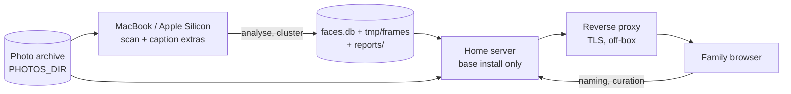

# Operations

> How Ritrova is installed, configured and run: the two install profiles, the command families, and the split between the machine that scans and the machine that serves.

## Modules

- **CLI surface**¹ — one `click` group holds every command. The group owns two
  settings only: `--db` (env `FACE_DB`) and `--photos-dir` (env `PHOTOS_DIR`).
  Both land in the click context and every subcommand reads them from there.
  Pattern: every heavy import sits *inside* the command body, so `--help` and
  the light commands never load torch, InsightFace or FAISS. Boundary: the CLI
  parses, prints and confirms. All real work lives in `analysis`, `cluster`,
  `db` and the service layer.
  - Notable: `_require_photos_dir` turns a missing `PHOTOS_DIR` into a click
    usage error. Commands that only touch the DB (`cluster`, `auto-assign`,
    `auto-merge`, `stats`, `export`, `scans`, `doctor`, `prune`) do not need it.

- **Install profiles**² — the base install carries no model runtime. It is
  enough for `serve`, clustering, assignment, browsing and every maintenance
  command. The `scan` extra adds InsightFace, YOLO, SigLIP and torch. The
  `caption` extra depends on `scan` and adds the MLX VLM plus the translator.
  Pattern: platform markers pick the runtime — the onnxruntime GPU build only
  on Windows x86-64, the MLX VLM only on Apple Silicon, and a platform-specific
  torch wheel index chosen by marker (CUDA on Windows, CPU-only on Linux, plain
  PyPI on macOS).
  - Notable: the Linux CPU-only index is deliberate. The default PyPI torch
    wheel pulls in the whole `nvidia-*` CUDA stack, which a headless home
    server cannot use.

- **Make targets**³ — thin wrappers over the CLI for the commands a household
  member runs. They exist to fix the environment file and the warmup
  pre-condition, not to add behaviour. `ENV_FILE` is `.env`, or `.env_windows`
  when `OS=Windows_NT`, and is passed through `uv run --env-file`. The targets
  also hold the two things that are not CLI commands at all: the Tailwind CSS
  build and the test/lint entry points.

- **Model warmup**⁴ — `ritrova warmup` constructs `FaceDetector` and
  `PetDetector` and exits. It exists so the first *interactive* use of a model
  (a manual finding drawn in the web UI) does not stall on roughly a gigabyte
  of weight downloads. `make serve` depends on a `.models-warmed` stamp file
  that is touched only when warmup succeeds.
  - Notable: warmup exits with an install hint, not a traceback, when the
    `scan` extra is absent. The stamp target swallows that failure, so `serve`
    still starts — it just starts cold. Delete the stamp to force a re-pull.

- **Serving-side model use**⁵ — the web app needs the `scan` extra for exactly
  one flow: creating a manual finding, which embeds the box the user drew.
  The detectors are lazy singletons held for the lifetime of the app process,
  because a per-request model load would take seconds.

- **VLM captioning**⁶ — Apple Silicon only, MLX only, and opt-in per run via
  `analyse --caption`. The platform check is a plain `Darwin` + `arm64` test
  made before any model loads. Boundary: captioning never gates detection;
  faces and pets are always detected on their own.

- **One-shot scripts**¹⁰ — `scripts/` holds offline DB migrations and
  backfills, each written for one historical repair and each documenting its
  own cause in its docstring. `scripts/investigations/` holds throwaway
  diagnostic reproductions. Nothing here is part of a routine workflow; the
  durable equivalents (`migrate-paths`, `backfill-gps`,
  `backfill-path-metadata`, `prune`, `doctor`) are CLI commands instead.

- **Auth design**⁹ — Ritrova is a local-network application. It has no login,
  no session, no CSRF layer and no user table, and that is the current design
  point rather than an oversight. A design document sketches an authenticated
  model for later work: Google OIDC, a family email allowlist, a server-side
  session table, an `HttpOnly` cookie, CSRF tokens on every write, and rate
  limiting at the reverse proxy. None of it is built.

## Data flow

The install profile follows the machine, so the topology matters more than any
single command.

The serving box reads the same photo tree, because the UI serves crops and
thumbnails from the original files.

**Deployment specifics live elsewhere.** What terminates TLS, which ports are
already taken on the serving host, and what else runs beside Ritrova are owned
by `docs/server-deployment-plan.md` while that work is in progress, and are
verified there against the hosts. This chapter does not restate them; each
workstream's facts land here once they are present state rather than intent.

Three consequences this repository does determine, whatever the host turns out
to be:

- `serve` provides neither TLS nor authentication, so anything in front of it
  owns both. Nothing in the app will refuse a request that reached it.
- Where the database file sits decides where three other things sit: the frame
  cache, the thumbnail cache and the run reports all derive from its parent
  directory. Putting the database inside a tree that something else
  synchronises or backs up therefore drags a live SQLite file, its WAL and two
  regenerable caches along with it.
- Per-request work that scales with archive size is felt on the serving host,
  which is the smaller machine — not on the one that does the scanning.

## Operational notes

**Configuration**
- Two variables carry everything: `PHOTOS_DIR` (the archive root) and
  `FACE_DB` (the SQLite file). Both have CLI flag equivalents.
- `.env` is loaded by `python-dotenv` at CLI import time¹. The make targets
  additionally pass `--env-file`, so a make-driven run works even when the
  process environment is empty.
- The CLI's own `FACE_DB` default points at the current directory, while
  `.env.example` points inside `data/`. Running without an env file therefore
  picks a different database than the documented setup.
- Paths in the DB are stored relative to `PHOTOS_DIR`. `--scan-dir` narrows
  what is walked without changing that base.

**Derived locations**
- Video frame cache: `<db dir>/tmp/frames`¹.
- Analysis reports: `<db dir>/reports/analysis-<timestamp>.html`⁷, written by
  default after every persisted `analyse` run.
- The DB file's location therefore decides where all runtime data lands.
- Model weights live outside the project: InsightFace under the user's home
  cache, SigLIP in the HuggingFace cache. YOLO weights are the exception — the
  default path is `data/yolo11m.pt`, relative to the working directory⁸, so
  scanning commands expect to run from the repo root.

**Scanning versus serving**
- Install the `scan` extra on the machine that runs `analyse`, and nothing
  more than the base install on the box that runs `serve`.
- The one crack in that split is manual-finding creation in the UI⁵, which
  needs the `scan` extra on the serving box too.
- `serve` binds `0.0.0.0:8787` by default and has no authentication of its own,
  so it belongs on a trusted local network. Exposing it beyond the LAN would
  put the whole access-control burden on a reverse proxy.

**Install-boundary failure modes**
- `warmup` without the `scan` extra: clean message, non-zero exit⁴.
- `analyse --caption` on a non-Apple-Silicon host, or without the `caption`
  extra: a click exception with the install command⁶.
- `analyse` with detection enabled but no `scan` extra: the detector import
  fails inside the command body with a raw `ModuleNotFoundError`¹.
- A manual finding on a base-install server: the lazy detector import fails
  inside the request⁵.

**Destructive commands and their guards**
- `analyse --force` deletes the existing scan and its findings for each source
  before re-scanning. In explicit-sources mode it first counts the findings and
  the manual assignments at risk and asks for confirmation; `-y` skips the
  prompt. In tree-walk mode it does **not** prompt — that is the expected
  bulk cadence¹.
- `scans prune` refuses to run without `--scan-id` and/or `--source-pattern`,
  so it can never prune everything. It lists the targets, counts the findings
  and the manually assigned ones, then confirms¹.
- `prune` collapses duplicate findings on a source. `--dry-run` reports only;
  otherwise it confirms. It always computes the report in dry-run mode first.
- `cleanup` dismisses tiny and blurry *uncurated* findings only — rows with no
  assignment at all. `--dry-run` reports without writing.
- `doctor` is report-only by default and exits non-zero when the DB is dirty,
  which makes it usable as a check. `--fix` deletes the orphans and confirms
  first. Orphans can only come from an external `sqlite3` session with foreign
  keys off; the app connection enforces them.
- `analyse --dry-run` runs the whole pipeline and persists nothing, which also
  suppresses the post-run clustering and the report.

**Analysis run shape**
- `analyse` is the single detection entry point. With no positional arguments
  it walks the tree; with file paths it processes just those. Already-scanned
  sources are skipped unless `--force`.
- Skipping is keyed on a `scan_type` label, which defaults to `subjects`, or
  `subjects+captions` with `--caption`. Overriding `--scan-type` lets an
  experiment run coexist beside the production data instead of colliding
  with it.
- A successful persisted run clusters its findings and writes the HTML report
  unless told not to. `--workers` exists but defaults to 1, because GPU
  inference is serialised.
- `--profile` prints per-step wall time split by photo and video, and
  `--sample` with `--sample-seed` gives a reproducible subset for A/B work.

**Diagnostics**
- `stats` prints the DB counters. `scans list` shows scan rows, optionally
  filtered by a GLOB on the source path. `export` dumps the DB as JSON.
  `doctor` checks referential health.
- `describe`, `describe-eval` and `translate-bench` are the VLM evaluation
  rig, not part of the normal workflow. `translate-bench` replays a CSV of
  recorded English captions through the translator alone, so translator
  variants can be compared without re-paying the captioning cost.

**CSS build**
- The UI stylesheet is built by a standalone `tailwindcss` binary invoked as
  `./tailwindcss` from the repo root³. That binary is git-ignored and no target
  fetches it, so a fresh clone must place it by hand before `make css` works.
  The built stylesheet is committed, so serving does not need the binary.

**Checks**
- The pre-commit hook runs ruff with `--fix`, ruff-format, and mypy over
  `src/`¹¹. `make lint` instead invokes ruff and mypy directly over `src/` and
  `tests/`, and skips formatting — the two do not agree.
- `make test` runs the whole suite, including Playwright tests that start their
  own uvicorn and drive Chromium.

## Related decisions

- [`../decisions/ADR-009-unified-analysis-pipeline.md`](../decisions/ADR-009-unified-analysis-pipeline.md) — one `analyse` pass with composable steps, and the `scan_type` taxonomy that drives skip logic.
- [`../decisions/ADR-010-analyse-performance-optimization.md`](../decisions/ADR-010-analyse-performance-optimization.md) — why `--profile` exists and why workers default to 1.
- [`../decisions/ADR-011-retire-vlm-default.md`](../decisions/ADR-011-retire-vlm-default.md) — captioning is opt-in, MLX-only, and never prefilters detection.
- [`../decisions/ADR-012-architecture-refactor.md`](../decisions/ADR-012-architecture-refactor.md) — the router/service split the CLI and app sit on top of.

## References

¹ `src/ritrova/cli.py` — `cli` group, `analyse`, `scans_prune`, `prune`, `doctor`, `cleanup`, lazy per-command imports
² `pyproject.toml` — `scan` and `caption` extras, platform markers, torch wheel indexes
³ `Makefile` — env-file selection, warmup stamp, CSS build, test and lint targets
⁴ `src/ritrova/cli.py` — `warmup`
⁵ `src/ritrova/services_domain/findings_service.py` — lazy `FaceDetector` / `PetDetector` singletons
⁶ `src/ritrova/describer.py` — `_prefers_mlx_backend`, `Describer`, `Translator`
⁷ `src/ritrova/analysis_report.py` — `default_analysis_report_path`, `write_analysis_report`
⁸ `src/ritrova/pet_detector.py` — `PetDetector` weight paths and device selection
⁹ `docs/auth-session-design-home-server.md` — intended auth and session model
¹⁰ `scripts/`, `scripts/investigations/` — offline migrations, backfills and diagnostics
¹¹ `.pre-commit-config.yaml` — ruff, ruff-format, mypy hooks

---

_Last updated: 2026-10-25 by Kipi_
