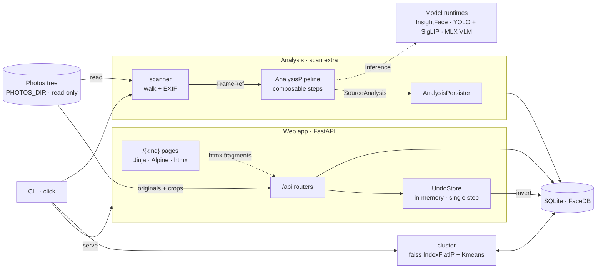

# Project Knowledge Index

> Personal photo archive for a single household. Detects and clusters faces in photos and videos using ArcFace embeddings. Detects dogs and cats using YOLO and SigLIP. Serves a web UI for naming, searching, and curating people and animals across years of photos. Holds 61K+ faces and 100K+ photos. Built for Apple Silicon with CoreML; most scanning works cross-platform.

This is the core-knowledge tree, maintained by Kipi. Every chapter is incrementally built from code scans and curated user-data. Strategic decisions live in `decisions/` and are written by `/grillme` or imported via `/kipi process`.

## Architecture

Three boundaries carry most of the design:

- **The pipeline never writes.** Analysis steps enrich a `SourceAnalysis` value object; `AnalysisPersister` alone touches the database.
- **Model runtimes are an optional install.** The base package serves and clusters; the `scan` extra adds them, and the `caption` extra adds the VLM on Apple Silicon only.
- **Photos are read-only.** Paths are the source of truth for dates, not EXIF.

## Chapters

- [`01-overview/`](./01-overview/) — what Ritrova is, who uses it, the `kind`/`species` vocabulary, scale, platform constraints
- [`02-architecture/`](./02-architecture/) — package layout, the scan/serve split, the `scan` and `caption` extras boundary, module dependencies
- [`03-analysis-pipeline/`](./03-analysis-pipeline/) — scan to database path: scanner, detection, pet detection, embeddings, captioning, run reports
- [`04-data-model/`](./04-data-model/) — schema and the `db/` layer: subjects, clusters, assignments, scans, path metadata, undo records
- [`05-clustering-assignment/`](./05-clustering-assignment/) — clustering, auto-assign, auto-merge, age splitting, similarity search, merge suggestions
- [`06-web-app/`](./06-web-app/) — routers, dependencies, templates and partials; route map and UI conventions
- [`07-operations/`](./07-operations/) — CLI surface, configuration, home-server deployment, auth and sessions
- [`08-testing/`](./08-testing/) — test layers, fixture and database conventions, the route-ordering regression guard, E2E coverage
- [`99-reference/`](./99-reference/) — glossary, environment variables, path conventions, model inventory

## Modules with their own knowledge

_None yet. To add one, `cd` into the module directory and run `/kipi-setup`._

## Decisions

See [`decisions/`](./decisions/) for ADRs (architecture decision records). Twelve are filed, covering model choice, clustering, age splitting, pet detection, video extraction, schema, auto-assign, captioning, the unified pipeline, performance, the VLM default, and the architecture refactor.

## How this is maintained

- `/kipi scan <path>` — deep-document a subtree
- `/kipi process` — process files dropped in `user-data/`
- `/kipi update` — reconcile recent code changes
- `/kipi status` — coverage report
- `/kipi-verify light|deep` — read-only audit: citations, ADRs, staleness, install
- `/grillme` — drive out tradeoffs adversarially, files an ADR into `decisions/`

_Last updated: 2026-10-24_
